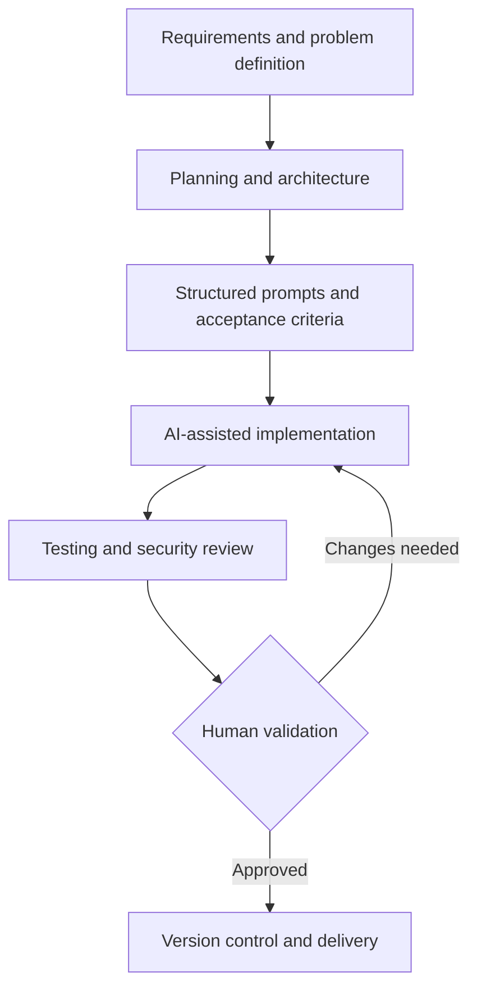

## About Me

I'm a Brazilian Full Stack Developer studying Systems Analysis and Development at FATEC. I'm passionate about software engineering, automation, artificial intelligence and digital entrepreneurship.

I enjoy turning ideas into practical applications, integrating systems and building digital products. My development approach combines structured planning, AI-assisted workflows, automated testing and human oversight.

Outside of technology, I enjoy video games and playing the guitar.

## Tech Stack

### Languages

### Frontend

### Backend & Database

### Development & Testing

### Additional Learning & Exploration

## AI-Assisted Software Engineering

I use AI as a development partner throughout the software lifecycle, not simply as a code generator.

| Tool | How I use it |
| --- | --- |
| ChatGPT | Requirements, architecture, technical planning, debugging, documentation and review. |
| OpenAI Codex | Repository analysis, implementation, refactoring, bug fixes and automated tests in VS Code. |
| Google Gemini | Research, alternative solutions, specialized AI agents and knowledge organization. |

My approach emphasizes structured prompts, acceptance criteria, incremental implementation, security checks and human review. I remain responsible for technical decisions and validating generated code.

### Development Workflow

I also explore specialized AI agents for project management, code auditing, feature design and product planning.

## Featured Projects

| Project | Description | Status |
| --- | --- | --- |
| [OfferHub](https://github.com/AlyssonHendryk/OfferHub) | Offer automation platform with Telegram integration, administrative dashboard, approval workflows and intelligent filtering. | In development |
| [Modus Destinatio](https://github.com/AlyssonHendryk/Modus-Destinatio) | Full stack inventory, order and business management system using Next.js, FastAPI and Supabase. Academic capstone project. | Academic project |
| AureinRPG | Modular tabletop RPG platform designed around customizable rules, campaigns, characters and maps. | Early development |
| [Hub School](https://github.com/AlyssonHendryk/hub-school) | Collaborative academic project featuring a REST API, JWT authentication and Supabase integration. | Completed |
| Pokédex | React and TypeScript application with search, filters, pagination and Pokémon details. | Learning project |

## Current Focus

- Full stack development and modular software architecture
- SaaS and digital product development
- Automation, bots and API integration
- AI agents and AI-assisted engineering workflows
- Application security, authentication and automated testing
- Continuous learning in cybersecurity and infrastructure

## GitHub Statistics

## Connect with Me

**Build. Learn. Automate. Evolve.**

